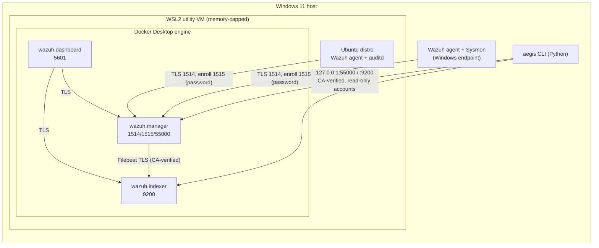

# Architecture

## Goals

1. Collect real endpoint telemetry into Wazuh with visible failure modes.
2. Keep detections, tests, and configuration in Git (detection-as-code).
3. Validate detections by comparing *observed* alerts with *expected* outcomes.
4. Support structured, evidence-backed investigations.
5. Measure pipeline health and detection performance with documented definitions.

## Layers

| Layer | Responsibility | Implementation | Phase |
|---|---|---|---|
| A — Telemetry sources | Generate security-relevant events | Windows host (Security log, Sysmon), WSL2 Ubuntu (auth, auditd, FIM) | 3 |
| B — Collection & normalization | Ship, decode, store events | Wazuh agents → manager (analysisd) → Filebeat → indexer | 2 |
| C — Detection engineering | Custom rules with docs and tests | `detections/wazuh/` (rule IDs 100000–100999) | 4 |
| D — Detection validation | Run approved scenarios, compare outcomes | Scenario manifests + runner, JSON results | 5 |
| E — Incident operations | Cases, evidence, timelines | Versioned case schema, append-only audit trail | 6 |
| F — Reliability & reporting | Health, metrics, reports | `aegis health`, metrics definitions, JSON/Markdown | 2, 7 |

## Components (Profile A)

All published ports bind to `127.0.0.1`. Nothing listens on LAN interfaces by default.

## Key decisions

| Decision | Choice | Reason |
|---|---|---|
| SIEM install method | Official `wazuh-docker` single-node, v4.14.8, consumed as a pinned, SHA-256-verified archive | Officially supported on Windows via Docker Desktop/WSL2; reproducible; upstream files stay pristine |
| Local changes to upstream | Compose override file + rendered configs in `deployment/wazuh/runtime/` | Upstream upgrades stay a version bump; AegisSOC deltas are reviewable |
| Linux endpoint | WSL2 Ubuntu with systemd | Already installed; no extra VM RAM. Limitations documented in [threat-model.md](threat-model.md) |
| Windows endpoint | The host itself, passive telemetry only | Only practical Windows endpoint within 16 GB; simulations limited to benign, reversible, approved tests |
| TLS verification | Always on; tooling pins the stack root CA and asserts the expected service hostname | Never disable verification to make a connection work |
| Tooling accounts | Dedicated read-only indexer user and Wazuh API user | Least privilege; admin credentials used only during provisioning |
| Network IDS | Deferred (Profile B) | Host has no span/tap visibility; Suricata on WSL would only see the VM's own traffic |

## Data flow and trust boundaries

1. **Endpoint → manager (1514/1515)**: the endpoint is untrusted. Agents may be compromised and send
   forged events. Enrollment requires a password; event channel is AES-encrypted by Wazuh.
2. **Manager → indexer**: internal Docker network, mutual TLS with the generated CA.
3. **Operator → dashboard/API/indexer**: localhost only, authenticated, TLS.
4. **Tooling → reports**: log content is untrusted text; reports redact known secrets and will escape
   rendered output (HTML/Markdown) when report rendering is added.

## Out of scope (initial release)

- Automated containment, account disabling, firewall changes.
- Multi-node clustering, HA.
- Exposure of any service beyond the host.
