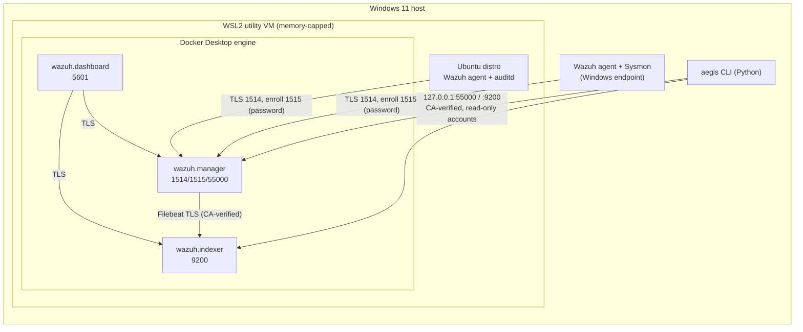

# Architecture

## Goals

1. Collect real endpoint telemetry into Wazuh with visible failure modes.
2. Keep detections, tests, and configuration in Git (detection-as-code).
3. Validate detections by comparing *observed* alerts with *expected* outcomes.
4. Support structured, evidence-backed investigations.
5. Measure pipeline health and detection performance with documented definitions.

## Layers

| Layer | Responsibility | Implementation | Phase |
|---|---|---|---|
| A. Telemetry sources | Generate security-relevant events | Windows host (Security log, Sysmon); Linux endpoint (journald, auditd where the kernel allows it, FIM) | 3 |
| B. Collection & normalization | Ship, decode, store events | Wazuh agents → manager (analysisd) → Filebeat → indexer | 2 |
| C. Detection engineering | Custom rules with docs and tests | `detections/wazuh/` (rule IDs 100000–100999) | 4 |
| D. Detection validation | Run approved scenarios, compare outcomes | Scenario manifests + runner, JSON results | 5 |
| E. Incident operations | Cases, evidence, timelines | Versioned case schema, append-only audit trail | 6 |
| F. Reliability & reporting | Health, metrics, reports | `aegis health`, metrics definitions, JSON/Markdown | 2, 7 |

## Components (Profile A)

All published ports bind to `127.0.0.1`. Nothing listens on LAN interfaces by default.

On a Linux host the same three containers run on Docker Engine directly, and the host itself is the Linux
endpoint (Wazuh agent, plus auditd because kernel audit is available outside WSL2). A Windows endpoint then
needs a separate machine or VM.

## Key decisions

| Decision | Choice | Reason |
|---|---|---|
| SIEM install method | Official `wazuh-docker` single-node, v4.14.8, consumed as a pinned, SHA-256-verified archive | Officially supported on Windows via Docker Desktop/WSL2 and on Linux via Docker Engine; reproducible; upstream files stay pristine |
| Host platform | Windows + Docker Desktop (verified), Linux + Docker Engine (supported, not yet verified live) | Same Compose files and tooling; host differences are isolated to `vm.max_map_count` handling, preflight advice, and the scenario executor |
| Local changes to upstream | Compose override file + rendered configs in `deployment/wazuh/runtime/` | Upstream upgrades stay a version bump; AegisSOC deltas are reviewable |
| Linux endpoint | WSL2 Ubuntu with systemd on Windows hosts; the host itself on Linux hosts | No extra VM RAM. WSL2 limitations documented in [threat-model.md](threat-model.md) |
| Windows endpoint | The Windows host itself, passive telemetry only | Only practical Windows endpoint within 16 GB; simulations limited to benign, reversible, approved tests |
| TLS verification | Always on; tooling pins the stack root CA and asserts the expected service hostname | Never disable verification to make a connection work |
| Tooling accounts | Dedicated read-only indexer user and Wazuh API user | Least privilege; admin credentials used only during provisioning |
| Network IDS | Suricata, optional, on a Linux agent (group `network-sensor`, Profile B); Zeek not added | No span/tap in the lab, so a sensor sees only its own interface; on Windows hosts Suricata in WSL would see only the VM. Suricata's eve.json metadata covers investigation needs that Zeek would otherwise add |

## Data flow and trust boundaries

1. **Endpoint → manager (1514/1515)**: the endpoint is untrusted. Agents may be compromised and send
   forged events. Enrollment requires a password; event channel is AES-encrypted by Wazuh.
2. **Manager → indexer**: internal Docker network, mutual TLS with the generated CA.
3. **Operator → dashboard/API/indexer**: localhost only, authenticated, TLS.
   **Operator → AegisSOC UI**: `127.0.0.1` only, plain HTTP on loopback, read-only. Access needs the random
   token printed at start (then an `HttpOnly`, `SameSite=Strict` cookie); requests with another `Host` header are
   refused (DNS rebinding). The UI reads only repository files and holds no stack credentials.
4. **Tooling → reports and terminal**: log content is untrusted text. Reports redact known secrets, Markdown/HTML
   output is escaped, and alert text printed to the terminal has control characters (ANSI escapes) neutralized.
5. **Tooling → endpoint (scenarios)**: commands come only from reviewed manifests, run through the configured
   executor (`wsl:<distro>` or `local` with `sudo -n`), and only after the endpoint proves it is the target agent.

## Out of scope (initial release)

- Automated containment, account disabling, firewall changes.
- Multi-node clustering, HA.
- Exposure of any service beyond the host.
