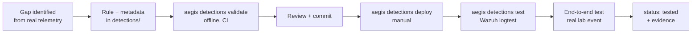

# Detection Methodology

## Lifecycle



1. **Start from a verified gap.** Check first what the built-in Wazuh ruleset already does with real log
   lines (logtest). Custom rules must add value, e.g. correlation or severity on sensitive paths.
2. **Write the rule and its metadata together.** `detections/wazuh/rules/aegissoc_<area>_rules.xml` and
   `detections/metadata/<id>.yml` (rationale, telemetry, ATT&CK, false positives, limitations,
   investigation, tests). Rule IDs: 100000–100999, never reused, by kind:

   | Kind | IDs | Purpose | Constraints |
   |---|---|---|---|
   | `detection` (default) | 100000–100799 | Detect attacker behavior | At least one ATT&CK mapping; level ≥ 1 |
   | `pipeline_check` | 100800–100899 | Prove a telemetry path works end to end | No ATT&CK mapping; level 1–5; excluded from coverage |
   | `suppression` | 100900–100999 | Silence verified false positives | Level 0; evidence and compensating controls documented |

3. **Validate offline** (`aegis detections validate`, also in CI): well-formed XML, ID range and uniqueness,
   metadata completeness, level consistency, ATT&CK ID format, at least one test, and known pitfalls
   (e.g. `<same_field>` on static fields).
4. **Deploy manually** (`aegis detections deploy`): refuses uncommitted `detections/` changes unless
   `--allow-dirty`, uploads via the Wazuh API, asks the manager to validate its configuration before the
   restart, and writes a record (git commit, dirty flag, file SHA-256) to `reports/runtime/`.
5. **Test with Wazuh's engine** (`aegis detections test`): positive and negative cases run through the
   manager's logtest in one session, so frequency/correlation state is real. Results: PASSED / FAILED /
   INCONCLUSIVE / SKIPPED (end-to-end cases).
6. **Test end-to-end** with a real, reversible lab action and verify cleanup. Only then set `status: tested`
   and reference the evidence file.

## Status meanings

| Status | Meaning |
|---|---|
| `experimental` | Rule exists; not yet shown to alert on real lab telemetry |
| `tested` | Logtest and/or end-to-end evidence recorded in `reports/examples/` |
| `deprecated` | Kept for history; must not be deployed |

`tested` means "observed to work in this lab under the recorded conditions". It is not a claim of
real-world detection rate.

## Scenario runner (end-to-end validation)

Manifests live in `scenarios/<platform>/<ID>-<name>.yml` and are reviewed like code.

```sh
aegis scenarios list
aegis scenarios run LNX-003 --authorize     # or --all --authorize
aegis coverage                              # matrix from the latest scenario report
```

Commands reach the Linux endpoint through the executor set by `AEGIS_LINUX_EXECUTOR`:

| Value | Default on | Runs commands | `run_as: root` |
|---|---|---|---|
| `wsl:<distro>` | Windows hosts (`wsl:Ubuntu`) | `wsl -d <distro> -- <argv>` | `wsl -d <distro> -u root -- <argv>` |
| `local` | Linux hosts | `<argv>` on this machine | `sudo -n -- <argv>`; run `sudo -v` first |

Safety model:

- Nothing executes without `--authorize`. Commands are fixed argument lists in reviewed manifests; no
  templating or input from alerts.
- Target agent must be the single active agent in the scenario's group; otherwise the scenario is SKIPPED.
- The executor must then report that agent's id and name (read from the endpoint's `client.keys`, key
  excluded); a mismatch or unreadable identity SKIPS the scenario before any other command runs.
- Prerequisites run first; a failure SKIPS the scenario before any change is made.
- Correlation scenarios wait for a quiet window so earlier events cannot cause a false PASS.
- Cleanup runs in a `finally` block, every step runs even if an earlier one fails, and a separate check
  verifies the result; failure → `CLEANUP_REQUIRED`.

Outcome rules (the command's exit code is recorded but never decides the outcome):

| Status | Condition |
|---|---|
| PASSED | All expected detection rules observed (positive) or telemetry observed and no forbidden rule (negative) |
| FAILED | Expected telemetry observed but detection missing, or a forbidden rule fired |
| INCONCLUSIVE | No alerts from the agent / expected telemetry absent, so detection cannot be judged |
| TIMED_OUT | Detection not observed and no telemetry expectation to judge against |
| SKIPPED | Target not ready or prerequisite failed; nothing executed |
| CLEANUP_REQUIRED | Cleanup or its verification failed (original outcome kept in the reason) |

## Lessons recorded so far

| Finding | Evidence | Guard |
|---|---|---|
| `<same_field>srcuser</same_field>` never matches (static field) | M2-LNX-002 logtest | Validator rejects `<same_field>` on static fields |
| Real-time FIM on individual files stops after atomic replace | M2-LNX-002 e2e | Linux group config watches directories only |
| Built-in PAM correlation (5551) needs a source IP; local failures have none | logtest of real lines | Rule 100100 correlates by user |
