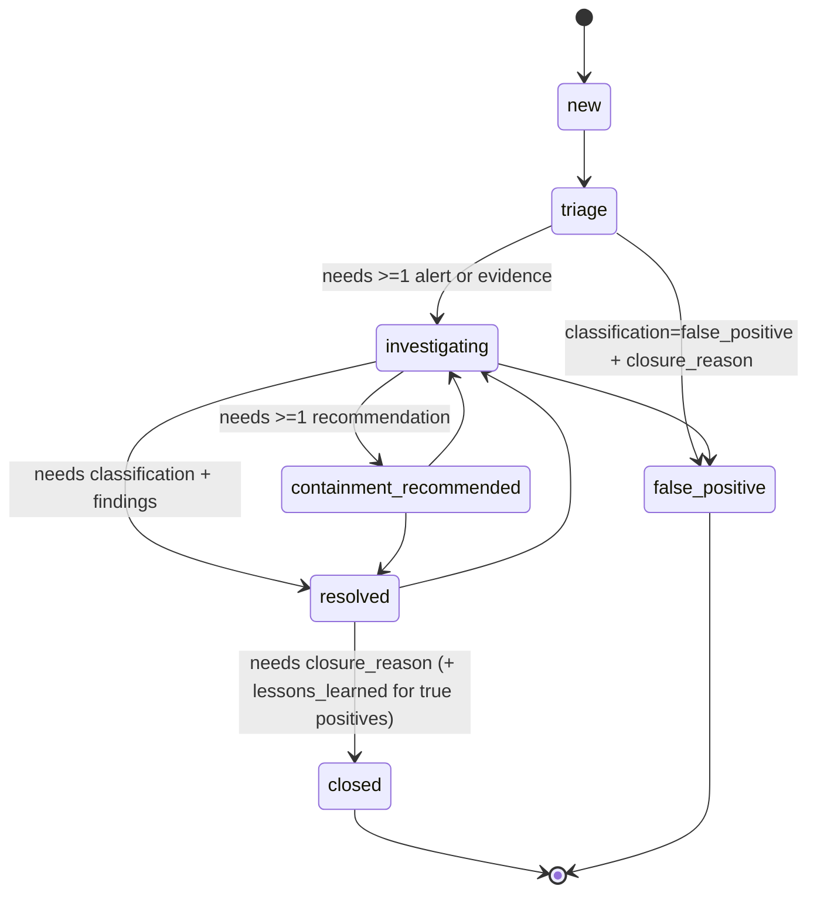

# Incident Response Workflow

Cases are JSON documents in `cases/` (git-ignored: real lab data), validated against
[schemas/case-1.0.json](../schemas/case-1.0.json). Sanitized reports go to `reports/examples/`.

## Lifecycle



`containment_recommended` means a recommendation was **recorded**, not that anything was contained.
AegisSOC performs no automated response actions.

## Commands

```powershell
aegis case alerts --rule 100200 --minutes 60          # find alert ids (read-only account)
aegis case new --title "..." --severity high
aegis case transition CASE-YYYYMMDD-NNN triage --reason "..."
aegis case attach CASE-... <alert_id> [<alert_id> ...]  # alert + raw evidence file with SHA-256
aegis case note | recommend | set <field> <value> | transition <status>
aegis case correct CASE-... <field> <value> --reason "..."   # only change allowed after closure
aegis case verify CASE-...                             # audit chain, replay, evidence hashes
aegis case report CASE-... --redact <hostname> <user>  # Markdown + JSON, escaped and redacted
```

## Integrity model

| Control | Mechanism | Verified by |
|---|---|---|
| Tamper-evident history | Each audit entry stores SHA-256 of its content and the previous entry's hash | Unit tests; real case copy with one edited field detected |
| Body matches history | Case body is re-derived by replaying the audit log on every load/save | `aegis case verify`, unit tests |
| Immutable after closure | Only `correction` (with reason) and `note` allowed in `closed`/`false_positive` | Real case: post-close `set` refused |
| Evidence integrity | Raw alert stored as a file with SHA-256; files never overwritten | `aegis case verify` |
| No lost updates | Save refuses if the case changed on disk since it was loaded | Regression test (found when two CLI runs interleaved) |
| Safe rendering | All case text HTML-escaped and Markdown-escaped; optional term redaction | Unit test with injected `` and `|` |

Limitations: integrity is tamper-*evident*, not tamper-*proof* — someone with write access can rewrite the
whole file and recompute every hash. Pushing case hashes to an external append-only store would be
needed for stronger guarantees. Actor names are self-declared (`--actor`); there is no authentication.

## Triage guidance

1. Treat a single alert as a lead. Look for corroboration (other sources, same user/host, timing).
2. Check whether an authorized scenario or a known change explains the activity before escalating.
3. Record uncertainty explicitly (`confidence`) and say which telemetry was missing.
4. Recommendations must be specific and are executed manually by a human after approval.

Worked example (real lab alerts, redacted): [reports/examples/CASE-example-report.md](../reports/examples/CASE-example-report.md).
